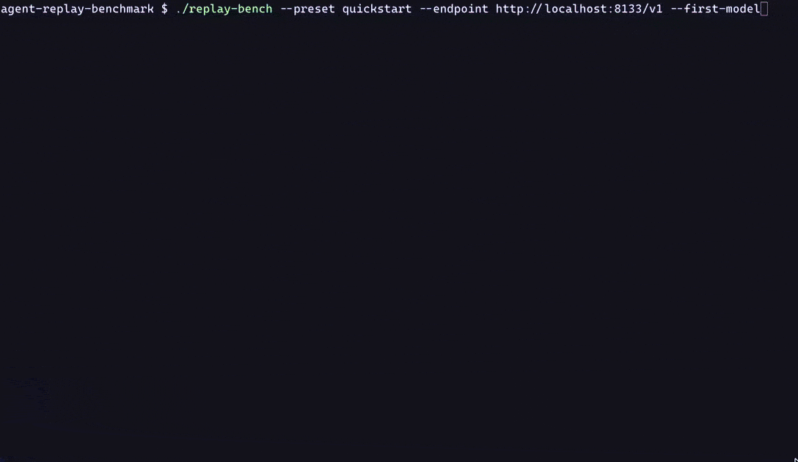

# agent-replay-benchmark

[](https://github.com/ghisguth/agent-replay-benchmark/actions/workflows/ci.yml)

Turn-by-turn replay of real coding-agent sessions against local OpenAI-compatible inference servers
(llama.cpp, Splash, Kapitsa, MTPLX, OMLX, mlx-dspark, mlx_lm.server, LM Studio, Ollama, ...). Evaluates model quality, tool-calling discipline,
and inference speed at realistic long contexts (up to 256k tokens).

<!-- demo: record a quickstart run, convert to GIF, save as docs/images/demo.gif -->


---

## Before you start

- **Tool calling.** The server must support tool calling (OpenAI `tools` / `tool_calls`): the replayed session is a
  coding agent that calls tools every turn.
- **Context.** A request is skipped when its prompt plus a 4,096-token output reserve exceeds the server's context.
  Load the model with at least: `quickstart` about 28k (largest prompt 23,729 tokens plus the reserve), `small` 32k,
  `medium` 64k, `large` (the default) 128k, `xlarge` 236k (each is the preset's maximum context, which already
  includes the reserve); `compaction`, `main` and `full` need about 236k as well (largest prompt 231.1k plus the reserve).
- **Time.** On an M2 Max 64GB the shipped samples took about 2-5 minutes for `quickstart` and about 1 hour for `large`
  (roughly 50 minutes to 1.5 hours depending on the engine and model); `full` takes many hours.
- **Comparing with the shipped samples.** All of them were run with `--temperature 0.6`; use the same setting for a
  comparable run.
- **omp** is oh-my-pi, the coding agent the replayed session was recorded with.
- **Maintainer tools.** The capture and maintainer tools in `tools/` (and the `make` workflows around them) need a git
  checkout, not a `pipx` install.
- **State files** record the endpoint host, the client device, the command line (argv) and the model's answers
  (including tool-call arguments). Look at one before you share it.

---

## What it is and why

Most LLM agent evaluations run full agent loops end-to-end. While valuable, end-to-end evaluations have major drawbacks for model and quant benchmarking:
- **Trajectory compounding**: A minor formatting difference or tool choice on turn 3 sends two runs down completely divergent trajectories, making comparisons across quants, engines, or model sizes noisy and unreplicable.
- **Enormous latency & cost**: Running full multi-hour agent sessions repeatedly takes days.
- **Unrealistic context depth**: Small synthetic benchmarks rarely test models at 64k, 128k, or 230k tokens with real-world tool call outputs, command results, and code edits.

**`agent-replay-benchmark`** uses **teacher-forced replay**:
- **Real agent sessions**: Replays every turn of real recorded coding-agent sessions (main agent turns, subagent turns, compaction calls), each sent with the actual recorded history up to that point. The server always sees realistic long context.
- **Turn-by-turn grading**: Each model response is graded against what the agent did and what verified reference models did at that exact turn.
- **Comprehensive metrics**: Measures time to first token (TTFT), prefill speed, decode speed, prompt cache hit rate, and structural failures per request.
- **Consistency & fairness**: Every model is tested on the identical prompt history under identical conditions.

---

## Quick start

### Installation

Requires Python 3.9+. Standard library only (no runtime dependencies). Pick one:

```bash
# Install the replay-bench command straight from GitHub
pipx install git+https://github.com/ghisguth/agent-replay-benchmark    # or: pip install git+https://...

# Or clone and run from the checkout, nothing to install
git clone https://github.com/ghisguth/agent-replay-benchmark.git
cd agent-replay-benchmark
./replay-bench --help   # same as: python3 replay_bench.py --help
```

Update an installed copy with `pipx upgrade agent-replay-benchmark` (or `pipx install --force git+...`).

`./replay-bench` picks the checkout's `.venv` if there is one, else the first Python 3.9+ it finds (`python3`,
`python3.13`, ...), and says how to get one when there is none. Symlink it onto your `PATH` to run it from anywhere,
e.g. `ln -s "$PWD/replay-bench" ~/.local/bin/replay-bench`.

`make` is only needed for development (tests, lint, maintainer workflows): `make bootstrap` creates `.venv` with the
dev extras, or use `pip install -e '.[dev]'`.

Below, `replay-bench` and `python3 replay_bench.py` are interchangeable.

### Running checks

```bash
# First try of a server or model: the first 5 requests of the coding session (prompts up to 23k tokens)
# (./replay-bench --preset quickstart ... is the same as python3 replay_bench.py --preset quickstart ...)
python3 replay_bench.py --preset quickstart --endpoint http://localhost:8080/v1

# Quick sanity check against a running server (4 generic cases; `--suite sanity` runs all 10)
python3 replay_bench.py --suite smoke --endpoint http://localhost:8080/v1

# Inspect what a preset would send without contacting a server (offline)
python3 replay_bench.py --preset small --dry-run

# Quick replay run with small context (9 requests, prompts up to 32k tokens)
python3 replay_bench.py --preset small --endpoint http://localhost:8080/v1

# Standard benchmark run (preset large: main agent up to 128k context)
python3 replay_bench.py --endpoint http://localhost:8080/v1
```

---

## Presets and selection options

`--preset NAME` selects a predefined benchmark slice (default: `large`).

| Preset | Replays | Requests | Max prompt | Use |
|---|---|---:|---:|---|
| `quickstart` | coding, main agent, requests 1–5 | 5 | 23.2k | first try of a server or model |
| `small` | coding, main agent up to 32k | 9 | 27.5k | quick checks, slow machines |
| `medium` | coding, main agent up to 64k | 24 | 59.2k | quick checks, slow machines |
| `large` *(alias `128k`)* | coding, main agent up to 128k | 58 | 123.9k | everyday model comparison (default) |
| `xlarge` *(alias `236k`)* | coding, main agent up to the compaction | 156 | 230.4k | long-context quality |
| `compaction` | coding, main agent, requests 1–217 | 217 | 231.1k | compaction call and the restart after it |
| `main` | coding, whole main session | 298 | 231.1k | the whole main session |
| `full` | coding, everything incl. subagents | 470 | 231.1k | everything, many hours |
| `judge` | one recorded match-judge case | 6 | 12.6k | match-judge case |
| `smoke` | 4 generic cases | 4 | – | quick server check |
| `sanity` | 10 generic cases (format, JSON, tools, math, recall) | 10 | – | does the model work at all |

### Custom selection flags

Custom selection options apply to replay suites (`coding` and `judge`); `smoke` and `sanity` take none. Passing selection options that contradict an explicit preset produces an error.

- `--max-context LIMIT`: Filter turns that fit within this context limit (choices: `32k`, `64k`, `128k`, `236k`, `full`, or an integer token count; k = 1024). Requests needing more prompt tokens plus a 4096-token reserve are omitted.
- `--no-subagents`: Replay only main agent requests, skipping subagent turns.
- `--turns A-B`: Replay requests A through B (inclusive, 1-based index).
- `--test ID`: Run a specific smoke or sanity case by id (not with replay suites).
- `--warmup-first-test`: Warm up with the first scored smoke test instead of a generic probe.

---

## Reading the results

### Verdicts

- **`PASS`**: The model produced a valid, well-formed response that advances the task without breaking tool schemas or task patterns.
- **`WARN`**: Recoverable issue or pattern anomaly that does not break execution:
  - *Schema warnings*: Missing required field, unknown key in a tool schema (which the agent framework drops or repairs), wrong parameter type.
  - *Off-pattern*: `off pattern: change (reference models: look)` when the model attempts to write or edit files before reading or investigating (where all reference models investigated).
  - *Early finish / stopped*: The model generated text where the agent framework expected continued tool calls, or a subagent concluded prematurely.
  - *Syntactic validation*: A write to a `.json`, `.py`, or `.csproj` file that produces invalid syntax.
- **`FAIL`**: Fatal error or unusable generation:
  - Empty response or reasoning only with no completion.
  - Generation cut off by token limit (`finish_reason: length`).
  - Tool arguments that fail JSON parsing.
  - Leaked markup written as raw text (e.g., `<tool_call>`, `<|im_start|>`) instead of native tool calls.
  - Infinite loops or runaway repetition (identical call repeated 3+ times, or repetitive text).
  - Broken compaction (compaction call emitting tool calls, or missing mandatory summary sections).
- **`SKIP`**: Request prompt plus the 4096-token output reserve exceeded the model's configured context window.

### Agreement rates

- **`same tools as recorded`**: Percentage of turns where the evaluated model called the exact same tools as the original recorded agent.
- **`in line with reference models`**: Percentage of turns where the model's first action matches an accepted action category (`look`, `wait`, `change`, `delegate`, `plan`, `<text>`).
  - *The two-model rule*: An action category is accepted for a given turn if the original recording took that kind of step, or at least two distinct reference models did (Qwen3.8-27B and Qwen3.8-Flash-Next: several quants or runs of one model count once). `look` (reading, searching, inspecting) is always accepted.

### Symbols in the tables

- `–`: no value: the server does not report it, or the figure does not apply to the row (for example the cache share on LM Studio, or the prompt size of a generic case).
- `~`: an estimate, not a figure the server reported: the client-side prefill progress of servers that report none (Ollama, LM Studio, vLLM, OMLX), and a change between an estimate and a server figure (shown dim, never as better or worse).

### Output tables

1. **Case Table**:
   - `Case`: Request ID (e.g. `R001_main_e0_t000`).
   - `Stream`: Session stream (`main/e0`, subagent ID, or `main/c0` for compaction).
   - `TTFT`: Time to first token (client wall-clock).
   - `Time`: Total request latency.
   - `In` / `Out`: Prompt tokens and generated output tokens.
   - `C%`: Prompt cache hit percentage (`cached_tokens / prompt_tokens`).
   - `Decode`: Generation speed in tokens/second (server reported if available, else client clock).
   - `Prefill`: Prompt processing speed in tokens/second.
   - `Verdict`: `PASS`, `WARN`, `FAIL`, or `SKIP`.
   - `Reason / Preview`: Failure/warning details or a preview snippet of the generation.
2. **Metrics Table**:
   - Wall time, median (p50) and 90th percentile (p90) for TTFT and total latency, total prompt/output/cached tokens, cache hit rate, end-to-end client tok/s, server native decode and prefill speeds.
3. **By Context Breakdown Table**:
   - Aggregates cases in 32k token context bands (`0-32k`, `32-64k`, `64-96k`, etc.; k = 1024). Shows verdict counts, agreement rates, decode speeds, and prefill speeds across context depths.
4. **Performance by Append Size Table**:
   - Breaks down prefill performance by the size of the newly appended (uncached) tokens: `< 1k`, `1-5k`, `>= 5k`.

---

## Comparing runs

Saved benchmark runs can be compared without contacting a server using `--state` and `--compare-state`.

```bash
# Compare a test run against a saved baseline run
python3 replay_bench.py --state states/run_candidate.jsonl --compare-state states/run_baseline.jsonl

# Compare a live run against a saved baseline run (the shipped samples used --temperature 0.6)
python3 replay_bench.py --endpoint http://localhost:8080/v1 --temperature 0.6 --compare-state states/run_baseline.jsonl
```

### How comparison works

- **File resolution**: A path passed to `--state` or `--compare-state` is used as given; a name is looked up in `states/`, `fixtures/refs/` and `fixtures/samples/`.
- **Baseline matching**: The baseline state must match the candidate run's suite and fixture SHA-256 digest.
- **Common cases**: Comparison evaluates the intersection of cases present in both files.
- **Delta columns**:
  - `ΔTime`: Percentage difference in request duration (`+` red/slower, `-` green/faster).
  - `ΔDecode`: Percentage difference in generation speed (`+` green/faster, `-` red/slower).
  - `ΔPrefill`: Percentage difference in prompt prefill speed.
  - `Base`: Baseline action: `=` when the first action matches the baseline; otherwise shows a verdict glyph and the baseline's action (e.g. `✅ todo`, `⚠️ bash`).
- **Summary delta rows**: The case table, Metrics table, and context breakdown tables display a `Δ` row or column comparing the candidate to the baseline.

---

## Report formats

The output format is controlled with `--report-format`:

### `tui` (default)
Interactive terminal table with color badges, progress display, and box-drawing borders:
```text
Agent replay · suite coding (58 requests) · Splash 1.6.0-m1 · MacBook Pro M2 Max 64GB · ctx 256k

unsloth/Qwen3.8-27B-GGUF:UD-Q4_K_M · localhost:8080
┌────────────────────┬─────────┬────────┬────────┬────────────┬───────────┬──────┬────────┬─────────┬─────────┬──────────────────────────────────────────────────────────────┐
│ Case               │ Stream  │   TTFT │   Time │         In │       Out │   C% │ Decode │ Prefill │ Verdict │ Reason / Preview                                             │
├────────────────────┼─────────┼────────┼────────┼────────────┼───────────┼──────┼────────┼─────────┼─────────┼──────────────────────────────────────────────────────────────┤
│ R001_main_e0_t000  │ main/e0 │  1m22s │  1m25s │     18,107 │       165 │   0% │   57.4 │   221.3 │ ✅ PASS │ call bash, bash                                              │
│ R002_main_e0_t001  │ main/e0 │  3.33s │  4.42s │     18,686 │        68 │  97% │   61.8 │   182.4 │ ✅ PASS │ call read                                                    │
│ R003_main_e0_t002  │ main/e0 │  16.7s │  26.8s │     21,901 │       417 │  85% │   41.1 │   194.8 │ ✅ PASS │ call todo, bash                                              │
│ R004_main_e0_t003  │ main/e0 │  3.78s │  12.0s │     22,531 │       321 │  97% │   39.1 │   171.0 │ ✅ PASS │ src is unchanged since 'e8a3b6714'. While traces run, readi… │
│ R005_main_e0_t004  │ main/e0 │  7.20s │  15.8s │     23,733 │       361 │  95% │   42.0 │   172.4 │ ✅ PASS │ call bash                                                    │
│ …                  │         │        │        │            │           │      │        │         │         │ …                                                            │
```

### `markdown`
Clean GitHub Flavored Markdown (pipes directly to a file via `> report.md` or renders via `mdcat`/`glow` in terminal):
```markdown
# Agent replay — suite coding

## Run

| Field     | Value                                       |
|-----------|---------------------------------------------|
| Server    | Splash 1.6.0-m1                             |
| Device    | MacBook Pro M2 Max 64GB                     |
| Endpoint  | localhost:8080                              |
| Model     | `unsloth/Qwen3.8-27B-GGUF:UD-Q4_K_M`        |
| Context   | 262,144 tokens (256k)                       |
| Suite     | coding, 58 requests                         |
| Selection | max context 128k, no subagents              |
| Sampling  | temperature 0.6, reasoning effort none sent |


## unsloth/Qwen3.8-27B-GGUF:UD-Q4_K_M

### Results

56 PASS · 2 WARN · 0 FAIL · 0 SKIP · same tools as recorded 43% · in line with reference models 57/58 (98%)

| Case                  | Stream    |  TTFT |     Time |        In |      Out |   C% | Decode | Prefill | Verdict    | Reason / Preview                                         |
|-----------------------|-----------|------:|---------:|----------:|---------:|-----:|-------:|--------:|------------|----------------------------------------------------------|
| **R001_main_e0_t000** | `main/e0` | 1m22s |  *1m25s* |    18,107 |    *165* |   0% |   57.4 |   221.3 | ✅ PASS    | call `bash`, `bash`                                     |
| **R002_main_e0_t001** | `main/e0` | 3.33s |  *4.42s* |    18,686 |     *68* |  97% |   61.8 |   182.4 | ✅ PASS    | call `read`                                              |
| **R003_main_e0_t002** | `main/e0` | 16.7s |  *26.8s* |    21,901 |    *417* |  85% |   41.1 |   194.8 | ✅ PASS    | call `todo`, `bash`                                     |
| **R004_main_e0_t003** | `main/e0` | 3.78s |  *12.0s* |    22,531 |    *321* |  97% |   39.1 |   171.0 | ✅ PASS    | *src is unchanged since 'e8a3b6714'. Whi…*               |
| **R005_main_e0_t004** | `main/e0` | 7.20s |  *15.8s* |    23,733 |    *361* |  95% |   42.0 |   172.4 | ✅ PASS    | call `bash`                                              |
```

### `chat`
Full conversational transcript formatted like a live agent UI, showing tool calls, inputs, diffs, and timing stats:
```text
Agent replay · suite coding (58 requests) · Splash 1.6.0-m1 · MacBook Pro M2 Max 64GB · ctx 256k

unsloth/Qwen3.8-27B-GGUF:UD-Q4_K_M · localhost:8080

── main/e0 · main agent ────────────────────────────────────────────────────────────────────────────────────────────────

 ❯ [IMPORTANT: User invoked the "f428-implement" skill; follow its instructions. Full skill below.]
   
   You are implementing ONE task of feature F-428 on LetUsCook.
   
   ## 0. The gate on starting — check this before anything else
   
   ```bash
   ./.venv/bin/python3 tools/f428.py show <ID>
   … (223 more lines)

╭──────────────────────────────────────────────────────────────────────────────────────────────────────────────────────╮
│ $ ./.venv/bin/python3 tools/f428.py show P12.13                                                                      │
╰──────────────────────────────────────────────────────────────────────────────────────────────────────────────────────╯
  recorded: bash: ./.venv/bin/python3 tools/f428.py show P12.13; ls -l Resources/features/f-428/briefs/P12.13.md

╭──────────────────────────────────────────────────────────────────────────────────────────────────────────────────────╮
│ $ ls -l Resources/features/f-428/briefs/P12.13.md                                                                    │
╰──────────────────────────────────────────────────────────────────────────────────────────────────────────────────────╯
  recorded: (no call)

 2026-11-07 22:24:30    Δ 1m24s     18K     165           81.8s     1.9/s   PASS  R001_main_e0_t000

  Read Resources/features/f-428/briefs/P12.13.md  · Reading P12.13 brief
  → # Brief — P12.13 · Auto-wrong census (C# CLI): relation and site of every auto-wrong debug/batch li… (171 lines)
```

Both chat formats use plain Unicode by default. On a color terminal with a [Nerd Font](https://www.nerdfonts.com/), `--icons` (or `REPLAY_BENCH_NERD_FONT=1`) replaces label words with icons; a terminal cannot tell whether its font has them, so they are opt-in. `--no-nerd-font` forces them off.

### `chat-compact`
Compact summary transcript collapsing consecutive tool invocations:
```text
Agent replay · suite coding (58 requests) · Splash 1.6.0-m1 · MacBook Pro M2 Max 64GB · ctx 256k

unsloth/Qwen3.8-27B-GGUF:UD-Q4_K_M · localhost:8080

── main/e0 · main agent ────────────────────────────────────────────────────────────────────────────────────────────────

  [IMPORTANT: User invoked the "f428-implement" skill; follow its instructions. Full skill below.]
  
  You are implementing ONE task of feature F-428 on LetUsCook.
  
  ## 0. The gate on starting — check this before anything else
  
  ```bash
  ./.venv/bin/python3 tools/f428.py show <ID>
  … (223 more lines)

● Updated todo list, ran 3 shell commands, read 1 file

● src is unchanged since e8a3b6714. While traces run, reading the P12.7 report and the production helpers the brief
  names.

  ⎿ Ran 4 shell commands, read 1 file

● Census confirmed: 57 auto-wrong debug lines, 44 window/compound+other rows for --pairs. Loading the CLI skill, then
  reading the production helpers.

  ⎿ Read 5 files, ran 4 shell commands, searched 1 time

  ⚠ R013_main_e0_t012 WARN: schema: bash unknown key 'description' (omp drops it)
```

### Comparison output
Side-by-side table with relative deltas against a baseline run (here a state from `fixtures/refs/` against one from `fixtures/samples/`, captured with `NO_COLOR=1 COLUMNS=150`; wider terminals add the In, Out and C% columns). Excerpt:
```text
Agent replay · suite coding (58 requests) · llama.cpp b12117 · MTP · MacBook Pro M2 Max 64GB · ctx 256k

unsloth/Qwen3.8-27B-GGUF:Q8_0 · localhost:8080
compared with: Splash 1.6.0-m1 · unsloth/Qwen3.8-27B-GGUF:UD-Q4_K_M (splash-1.6.0-m1_MBP-M2Max-64GB_unsloth-Qwen3.8-27B-GGUF-UD-Q4_K_M_coding-large_t0.6_20261107-222306.jsonl, 58 common requests)
┌────────────────────┬─────────┬──────────┬──────────┬──────────┬──────────┬─────────┬──────────┬───────────┬─────────┬─────────────┬──────────────┐
│ Case               │ Stream  │     TTFT │     Time │   Decode │  Prefill │   ΔTime │  ΔDecode │  ΔPrefill │ Verdict │ Base        │ Reason       │
├────────────────────┼─────────┼──────────┼──────────┼──────────┼──────────┼─────────┼──────────┼───────────┼─────────┼─────────────┼──────────────┤
│ R001_main_e0_t000  │ main/e0 │    1m43s │    1m52s │     26.9 │    176.6 │  +31.9% │   -53.2% │    -20.2% │ ✅ PASS │ =           │ call bash, … │
│ R002_main_e0_t001  │ main/e0 │    4.32s │    6.84s │     27.8 │    145.7 │  +54.8% │   -55.0% │    -20.1% │ ✅ PASS │ =           │ call read    │
│ R003_main_e0_t002  │ main/e0 │    21.4s │    49.1s │     22.3 │    152.9 │  +83.2% │   -45.7% │    -21.5% │ ⚠️ WARN │ ⚠ todo      │ off pattern… │
│ …                  │         │          │          │          │          │         │          │           │         │             │              │
├────────────────────┼─────────┼──────────┼──────────┼──────────┼──────────┼─────────┼──────────┼───────────┼─────────┼─────────────┼──────────────┤
│ Baseline           │         │    10.8s │   52m16s │     34.5 │    120.3 │         │          │           │ 55/3/0  │             │ Splash 1.6.… │
│ This run           │         │    14.4s │    1h35m │     15.4 │     93.9 │         │          │           │ 56/2/0  │             │              │
│ Δ                  │         │   +33.1% │   +82.0% │   -55.5% │   -21.9% │         │          │           │         │             │              │
└────────────────────┴─────────┴──────────┴──────────┴──────────┴──────────┴─────────┴──────────┴───────────┴─────────┴─────────────┴──────────────┘

56 PASS · 2 WARN · 0 FAIL · 0 SKIP · same tools as recorded 50% · in line with reference models 56/58 (97%)

▸ Metrics

┌─────────────────────────────────────┬──────────────────────────────────┬────────────────────┬─────────┐
│ Metric                              │ Splash 1.6.0-m1 · unsloth/Qwen3… │           This run │       Δ │
├─────────────────────────────────────┼──────────────────────────────────┼────────────────────┼─────────┤
│ Requests                            │                               58 │                 58 │         │
│ P/W/F                               │                           55/3/0 │             56/2/0 │         │
│ Same tools as recorded %            │                              43% │                50% │ +6.9 pt │
│ In line %                           │                              97% │                97% │ +0.0 pt │
│ Wall time (sum of requests)         │                           52m16s │              1h35m │  +82.0% │
│ TTFT p50 / p90                      │                    10.8s / 35.1s │      14.4s / 46.2s │  +33.1% │
│ Request time p50 / p90              │                    30.8s / 2m01s │      1m04s / 4m01s │ +106.3% │
│ Prompt tokens                       │                        4,323,252 │          4,325,456 │   +0.1% │
│ Cache hit (cached ÷ prompt)         │                            97.0% │              97.1% │ +0.0 pt │
│ Output tokens                       │                           67,855 │             64,897 │   -4.4% │
│ Output per request                  │                            1,170 │              1,119 │   -4.4% │
│ Decode tok/s (client)               │                             31.5 │               14.7 │  -53.4% │
│ End-to-end tok/s                    │                             21.6 │               11.4 │  -47.5% │
│ Native decode tok/s p25 / p50 / p75 │               28.8 / 34.5 / 40.4 │ 14.0 / 15.4 / 18.1 │  -55.5% │
│ Native prefill tok/s p50            │                              120 │                 94 │  -21.9% │
└─────────────────────────────────────┴──────────────────────────────────┴────────────────────┴─────────┘
Baseline: Splash 1.6.0-m1 · unsloth/Qwen3.8-27B-GGUF:UD-Q4_K_M.

… (the By context, Verdict changes, Anomalies and Prefill by append size tables follow)
```

---

## State files and resume

Runs are automatically persisted to JSONL state files in `states/`. Each line is appended, flushed, and `fsync`ed immediately after each case finishes.

### Naming convention

By default, files are named:
```text
states/<backend>-<version>[_<device>]_<model-slug>_<preset or suite>[_t<temp>][_e-<effort>][_<run note>]_<timestamp>.jsonl
```
Example:
`states/splash-1.6.0-m1_MBP-M2Max-64GB_qwen3.8-27b_coding-large_t0.6_20261108-161443.jsonl`

### State file options

- `--state-file FILE`: Specify an explicit output path instead of the automatic path.
- `--no-save-state`: Run without writing a state file.
- `--run-note TEXT`: Attach a custom note (1–60 chars, e.g. `MTP`, `DFlash2`, or `spec-v2`). Recorded in the state header, displayed in tables, and included in the filename.
- `--server-version VERSION`: Override detected server version string.

### Resuming interrupted runs

If a run is aborted (Ctrl+C, crash, or server timeout), it can be seamlessly resumed:
```bash
python3 replay_bench.py --resume states/interrupted_run.jsonl
```
- Cases that already completed with a valid grade are not re-sent.
- Re-executes any failed or uncompleted requests.
- All original run settings (suite, fixture, model, sampling) are preserved and verified. Presentation options (`--report-format`, `--no-mdcat`) may be adjusted freely.

---

## Supported servers

Any OpenAI-compatible `/v1/chat/completions` server works (vLLM and others without a page below run as "generic"). The
runner probes the server to recognise it and to read what it reports; an unknown server runs as "generic" with the
OpenAI `usage` block and client-side timing. One page per
server (detection, telemetry, flags, a quickstart report) is in [`docs/servers/`](docs/servers/README.md).

| Server | Page | Detected by | Prefill progress | Native timings |
|---|---|---|---|---|
| llama.cpp | [llamacpp.md](docs/servers/llamacpp.md) | `/props` | real (`return_progress`) | `timings` |
| Splash | [splash.md](docs/servers/splash.md) | `/status` | real (`return_progress`) | `timings`, `metrics` |
| Kapitsa | [kapitsa.md](docs/servers/kapitsa.md) | `/cluster` | real (request header) | `usage.kapitsa` |
| MTPLX | [mtplx.md](docs/servers/mtplx.md) | `/health` | real (polled snapshot) | `mtplx_stats` |
| Ollama | [ollama.md](docs/servers/ollama.md) | `/api/version` | estimate (`~`) | `timings`, cached tokens |
| LM Studio | [lmstudio.md](docs/servers/lmstudio.md) | `/api/v0/models` | estimate (`~`) | `stats` via `/api/v0` |
| OMLX | [omlx.md](docs/servers/omlx.md) | `owned_by`, `/admin/api/stats` | estimate (`~`) | `usage` timings, cached tokens |
| mlx-dspark | [mlx-dspark.md](docs/servers/mlx-dspark.md) | `Server` header, `/doctor` | estimate (`~`) | `x_mlx_dspark` |
| mlx_lm.server | [mlx_lm.md](docs/servers/mlx_lm.md) | weak: `Server: BaseHTTP/`, `/health` | estimate (`~`) | client clock, real cache counts |

LM Studio chat requests go to `/api/v0/chat/completions`, the route that carries the `stats` object; `/v1` leaves it
out. When that route rejects the first request (HTTP 404, 400 or 405, or an empty answer) the benchmark switches to
`/v1/chat/completions` for the rest of the run, says so on stderr and records the route in the state file.

`REPLAY_BENCH_DEBUG=1` logs every request URL and the keys of the last stream chunk to stderr, for finding out why a
server shows no native speeds.

### Checking a server

```bash
python3 replay_bench.py --discover --endpoint http://localhost:8080/v1
python3 replay_bench.py --discover --endpoint http://localhost:8080/v1 --model Qwen3.8-27B
```

`--discover` (alias `--list`) sends no chat request. It prints the models the server serves (the ones `--model` and
`--first-model` select are ticked) and, for those, what the server reports: kind, version, build, device and whether
prefill progress is real per server, quant, context size, family and runner per model (Ollama and LM Studio only). Exit
code 0 when at least one model matched, 1 when none did, so it works in scripts.

`--model` is a case-insensitive substring; `--model exact:NAME` matches the whole id (`exact:Foo` selects `Foo` but not
`Foo:xxx`). The flag repeats.

### Authentication and TLS

- `--api-key KEY`: bearer token (or `$OPENAI_API_KEY`).
- `--ca-file FILE`: extra CA bundle for `https://` endpoints.
- `--insecure`: skip certificate verification.

---

## Sanity suite

`--suite sanity` (or `--preset sanity`) runs ten generic cases graded by validators only, with no judge model: a
conventional-commit line, routed JSON, one tool call, a tool conversation, a counting stop condition, two tool calls in
one turn, tool choice among three, a word problem, a code hidden in about 8k tokens of notes, and a Unicode echo.
`smoke` is the first four. `tools/mock_server.py` answers all ten correctly. A saved sanity or smoke state is regraded
with the current validators when shown again.

---

## Fixtures, references and samples

- `fixtures/conv-3.json.gz`: the `coding` fixture, a 470-request coding-agent session (298 main-agent requests
  including the compaction, and two subagents with 72 and 100 requests). `fixtures/judge.json.gz` is the `judge` case.
- `fixtures/conv-3.checks.json`: expectations per turn (required compaction headings, subagent report patterns,
  accepted action categories). Built by `tools/build_checks.py` from the references.
- `fixtures/refs/` (6 runs, see [`fixtures/refs/README.txt`](fixtures/refs/README.txt)): the expected answers, runs of high-fidelity models (Qwen3.8-27B at Q8_0 and mlx 4bit,
  Qwen3.8-Flash-Next at GSQ-RCO and UD-IQ1_S, on llama.cpp and Splash). Steps are counted per distinct model, not per
  run.
- `fixtures/samples/` (24 runs): shipped runs to compare with, never used for grading. They include the quickstart run
  of every supported engine on an M2 Max 64GB with Qwen3.8-27B, and larger runs of several models and quants.
- `docs/capture-traces.md`: how to capture a session and build a fixture (needs raw session sources).

```bash
# your run against the quickstart run of Splash with the GGUF model, no server needed for the sample
python3 replay_bench.py --state states/my_run.jsonl --compare-state coding-quickstart_t0.6_gguf
```

A name given to `--state` or `--compare-state` is a path, a file name or a unique substring of one, searched in
`states/`, then `fixtures/refs/`, then `fixtures/samples/`. An ambiguous name lists the matches, an unknown one suggests
the closest names.

### Tools

These need a git checkout (see "Before you start").

- `make triage` (`tools/triage_states.py`): what is new in `states/` since the last triage.
- `make add-ref FILE=states/run.jsonl` (`tools/add_ref.py`): scrubs host names, scans for personal data, copies the run
  into `fixtures/refs/` and rebuilds `conv-3.checks.json`.
- `make add-sample FILE=states/run.jsonl`: the same into `fixtures/samples/`, checks untouched.
- `tools/replay_divergence.py`: tool-choice divergence matrix across saved runs.
- `tools/mock_server.py`: mock servers (llama.cpp, MTPLX, Ollama, LM Studio, mlx-dspark, mlx_lm, generic) on 127.0.0.1 for tests.
- `tools/proxy.py`, `tools/omp_*.py`, `tools/pii_patterns.py`: capture proxy and fixture build pipeline, see
  `docs/capture-traces.md`.

---

## Development

See [CONTRIBUTING.md](CONTRIBUTING.md) and [AGENTS.md](AGENTS.md).

```bash
make bootstrap    # .venv with ruff (needs network)
make test         # unit tests, offline
make integration  # the CLI against tools/mock_server.py on 127.0.0.1
make lint         # ruff
make smoke ENDPOINT=http://localhost:8080/v1   # smoke suite against a server
```

---

## License

MIT, see [LICENSE](LICENSE). The replay fixtures contain material derived from oh-my-pi (also MIT); see
[THIRD_PARTY_NOTICES.md](THIRD_PARTY_NOTICES.md).
